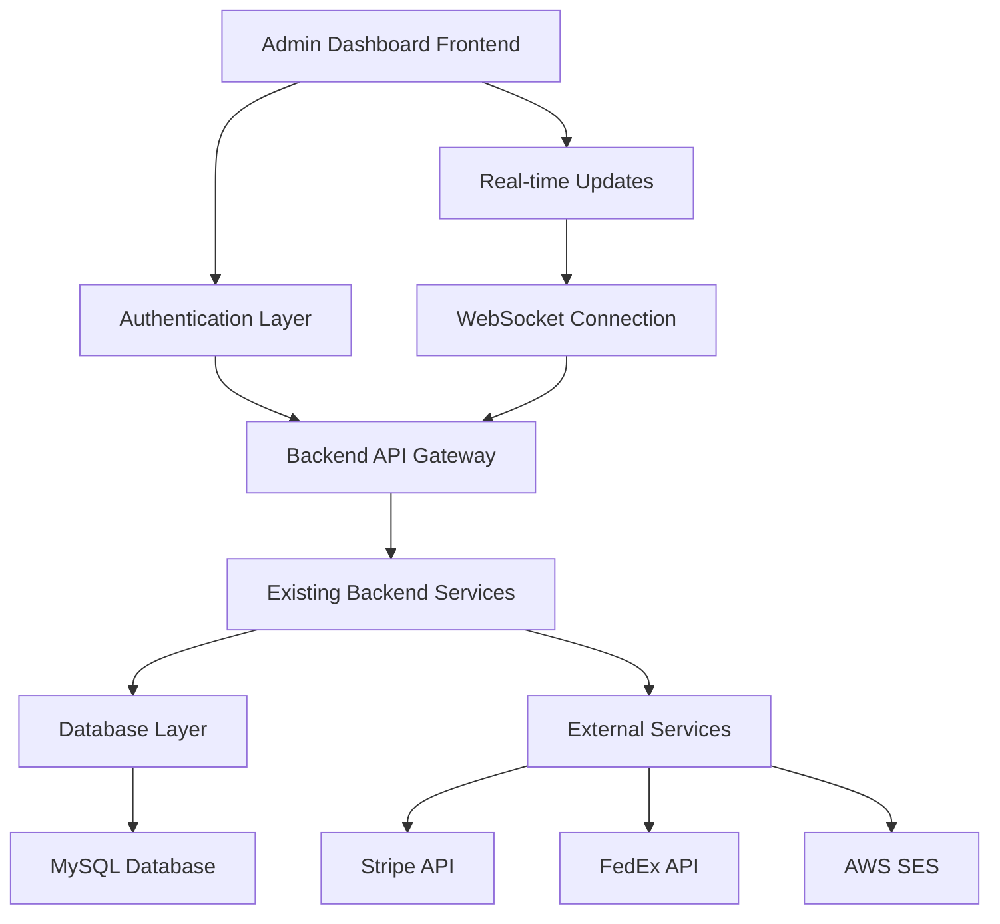

# Admin Dashboard Design Document

## Overview

The admin dashboard will be a comprehensive web-based interface built as a separate Next.js application that provides authorized staff and administrators with powerful tools to manage all aspects of the bed texture e-commerce platform. The dashboard will integrate with the existing backend API infrastructure and provide real-time insights, management capabilities, and administrative functions.

## Architecture

### High-Level Architecture



### Technology Stack

**Frontend:**
- **Framework:** Next.js 14+ with App Router
- **UI Library:** Tailwind CSS with Headless UI components
- **State Management:** React Context + useReducer for complex state
- **Charts/Analytics:** Chart.js or Recharts for data visualization
- **Real-time:** WebSocket connection for live updates
- **Authentication:** JWT tokens with HttpOnly cookies

**Backend Integration:**
- **API Communication:** Existing Express.js backend with new admin-specific routes
- **Authentication:** Enhanced role-based access control using existing auth middleware
- **Database:** Existing MySQL database with new admin-specific views and procedures
- **File Upload:** Integration with existing image service for bulk operations

### Security Architecture

- **Authentication:** Multi-factor authentication for admin accounts
- **Authorization:** Role-based permissions (admin, staff, manager)
- **Session Management:** Secure session handling with automatic timeout
- **CSRF Protection:** Token-based CSRF protection for all admin actions
- **Audit Logging:** Comprehensive logging of all administrative actions
- **IP Restrictions:** Optional IP whitelisting for admin access

## Components and Interfaces

### 1. Authentication System

#### Login Component
```javascript
// AdminLogin.jsx
- Multi-step authentication (username/password + 2FA)
- Remember device functionality
- Password strength requirements
- Account lockout after failed attempts
- Integration with existing auth middleware
```

#### Role Management
- **Admin:** Full system access
- **Manager:** Product and order management
- **Staff:** Limited product and customer support access
- **Viewer:** Read-only access to reports and analytics

### 2. Dashboard Overview

#### Main Dashboard Component
```javascript
// DashboardOverview.jsx
- Real-time KPI widgets (sales, orders, customers)
- Interactive charts for revenue trends
- Quick action buttons for common tasks
- System health indicators
- Recent activity feed
```

#### KPI Widgets
- **Sales Metrics:** Today/Week/Month revenue, conversion rates
- **Order Metrics:** Order count, average order value, fulfillment status
- **Inventory Alerts:** Low stock warnings, out-of-stock items
- **Customer Metrics:** New registrations, active users, support tickets

### 3. Product Management Interface

#### Product List Component
```javascript
// ProductList.jsx
- Searchable and filterable product grid/list view
- Bulk operations (price updates, status changes)
- Quick edit inline functionality
- Image thumbnail previews
- Status indicators (draft, pending, approved)
```

#### Product Editor
```javascript
// ProductEditor.jsx
- Rich text editor for descriptions
- Multi-image upload with drag-and-drop
- Variant management (size, color, pricing)
- SEO optimization fields
- Approval workflow integration
```

#### Bulk Operations
- CSV import/export functionality
- Batch price updates
- Category reassignment
- Status changes for multiple products

### 4. Order Management System

#### Order Dashboard
```javascript
// OrderDashboard.jsx
- Order pipeline view (pending → shipped → delivered)
- Advanced filtering (date, status, customer, amount)
- Bulk status updates
- Export functionality for accounting
```

#### Order Details
```javascript
// OrderDetails.jsx
- Complete order information display
- Customer communication history
- Payment and refund management
- Shipping label generation
- Return processing interface
```

### 5. Customer Management

#### Customer List
```javascript
// CustomerList.jsx
- Searchable customer database
- Customer segmentation tools
- Lifetime value calculations
- Communication history
```

#### Customer Profile
```javascript
// CustomerProfile.jsx
- Complete customer information
- Order history and analytics
- Support ticket management
- Account status controls
```

### 6. Inventory Management

#### Inventory Dashboard
```javascript
// InventoryDashboard.jsx
- Real-time stock levels
- Low stock alerts with reorder suggestions
- Inventory movement tracking
- Supplier management
```

#### Stock Management
```javascript
// StockManagement.jsx
- Manual stock adjustments
- Purchase order generation
- Inventory valuation reports
- Movement history and audit trail
```

### 7. Analytics and Reporting

#### Analytics Dashboard
```javascript
// AnalyticsDashboard.jsx
- Interactive charts and graphs
- Custom date range selection
- Comparative analysis tools
- Export capabilities (PDF, Excel)
```

#### Report Generator
- **Sales Reports:** Revenue, profit margins, tax summaries
- **Inventory Reports:** Turnover, aging, valuation
- **Customer Reports:** Acquisition, retention, lifetime value
- **Financial Reports:** Payment processing, refunds, fees

### 8. System Configuration

#### Settings Panel
```javascript
// SystemSettings.jsx
- Site configuration (name, logo, contact info)
- Payment gateway settings
- Shipping and tax configuration
- Email template management
```

#### User Management
```javascript
// UserManagement.jsx
- Admin user creation and management
- Role assignment and permissions
- Session monitoring and control
- Password policy enforcement
```

## Data Models

### Admin User Model
```javascript
{
  id: "USER0000000001",
  email: "admin@bedtexture.com",
  role: "admin", // admin, manager, staff, viewer
  permissions: ["products.read", "products.write", "orders.manage"],
  lastLogin: "2025-01-15T10:30:00Z",
  mfaEnabled: true,
  ipRestrictions: ["192.168.1.0/24"]
}
```

### Dashboard Analytics Model
```javascript
{
  period: "today", // today, week, month, custom
  metrics: {
    revenue: { current: 15420.50, previous: 12350.00, change: 24.8 },
    orders: { current: 45, previous: 38, change: 18.4 },
    customers: { current: 12, previous: 8, change: 50.0 },
    conversion: { current: 3.2, previous: 2.8, change: 14.3 }
  },
  charts: {
    salesTrend: [...], // Time series data
    topProducts: [...], // Product performance
    customerSegments: [...] // Customer analytics
  }
}
```

### Product Management Model
```javascript
{
  filters: {
    status: ["draft", "pending", "approved"],
    category: "CAT001",
    priceRange: { min: 0, max: 1000 },
    stockLevel: "low" // all, low, out-of-stock
  },
  sorting: { field: "created_at", direction: "desc" },
  pagination: { page: 1, limit: 50, total: 1250 }
}
```

## Error Handling

### Frontend Error Handling
- **Network Errors:** Retry mechanisms with exponential backoff
- **Validation Errors:** Real-time form validation with clear error messages
- **Permission Errors:** Graceful degradation with appropriate messaging
- **Session Expiry:** Automatic redirect to login with session restoration

### Backend Error Handling
- **Database Errors:** Transaction rollback and error logging
- **External API Errors:** Fallback mechanisms and user notification
- **File Upload Errors:** Progress tracking and error recovery
- **Rate Limiting:** Queue management and user feedback

### Error Logging and Monitoring
```javascript
// Error tracking integration
{
  errorId: "ERR_2025_001",
  timestamp: "2025-01-15T10:30:00Z",
  userId: "USER0000000001",
  action: "product.update",
  error: "Database connection timeout",
  context: { productId: "PROD0000000123", operation: "image_upload" },
  severity: "high"
}
```

## Testing Strategy

### Unit Testing
- **Component Testing:** React Testing Library for UI components
- **Service Testing:** Jest for business logic and API integration
- **Utility Testing:** Pure function testing for calculations and formatting

### Integration Testing
- **API Integration:** Test admin endpoints with different user roles
- **Database Integration:** Test complex queries and transactions
- **External Service Integration:** Mock external APIs (Stripe, FedEx)

### End-to-End Testing
- **User Workflows:** Complete admin tasks from login to completion
- **Cross-browser Testing:** Ensure compatibility across modern browsers
- **Performance Testing:** Load testing for dashboard with large datasets

### Security Testing
- **Authentication Testing:** Test login, session management, and permissions
- **Authorization Testing:** Verify role-based access controls
- **Input Validation:** Test for XSS, SQL injection, and other vulnerabilities
- **Session Security:** Test session timeout and concurrent session handling

## Performance Considerations

### Frontend Optimization
- **Code Splitting:** Lazy load dashboard sections
- **Caching:** Implement intelligent caching for frequently accessed data
- **Virtual Scrolling:** Handle large datasets efficiently
- **Image Optimization:** Lazy loading and responsive images

### Backend Optimization
- **Database Indexing:** Optimize queries for admin operations
- **Caching Layer:** Redis for frequently accessed admin data
- **Pagination:** Efficient pagination for large datasets
- **Background Jobs:** Queue heavy operations (bulk updates, reports)

### Real-time Updates
- **WebSocket Implementation:** Live updates for orders, inventory, and notifications
- **Selective Updates:** Only update changed data to minimize bandwidth
- **Connection Management:** Handle connection drops and reconnection

## Deployment and Infrastructure

### Development Environment
- **Local Development:** Docker Compose setup with hot reloading
- **Environment Variables:** Separate config for admin-specific settings
- **Database Seeding:** Admin user creation and test data

### Production Deployment
- **Separate Subdomain:** admin.bedtexture.com for admin interface
- **SSL/TLS:** Enhanced security for admin access
- **CDN Integration:** Static asset optimization
- **Monitoring:** Application performance and error tracking

### Security Hardening
- **IP Whitelisting:** Restrict admin access to specific IP ranges
- **VPN Requirements:** Optional VPN access for enhanced security
- **Regular Security Audits:** Automated vulnerability scanning
- **Backup and Recovery:** Regular backups with disaster recovery procedures