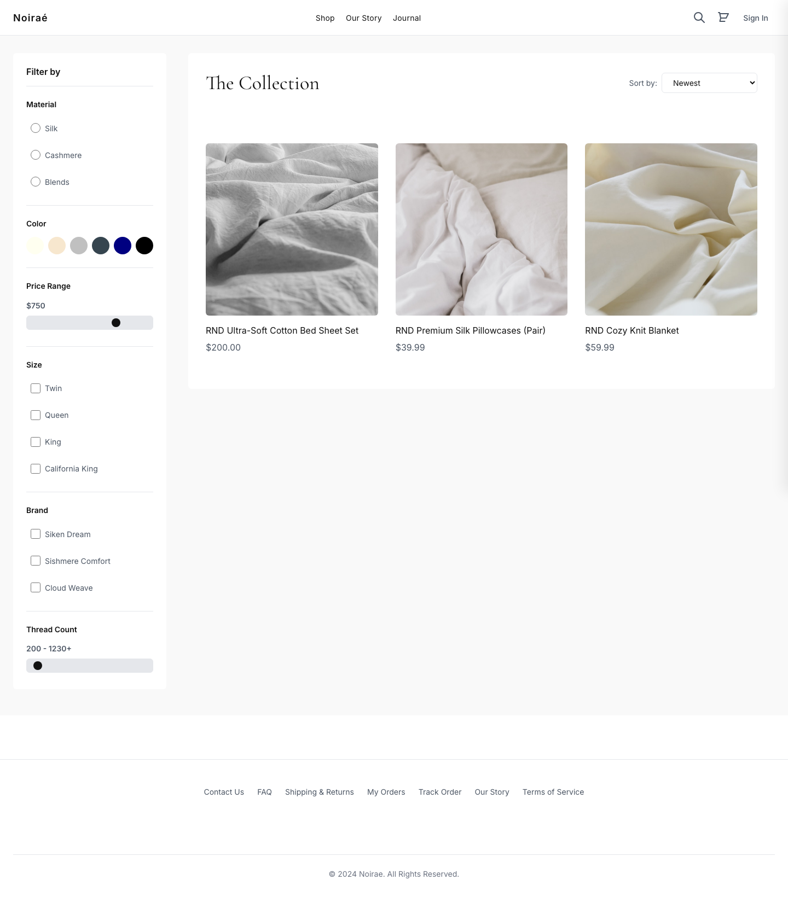
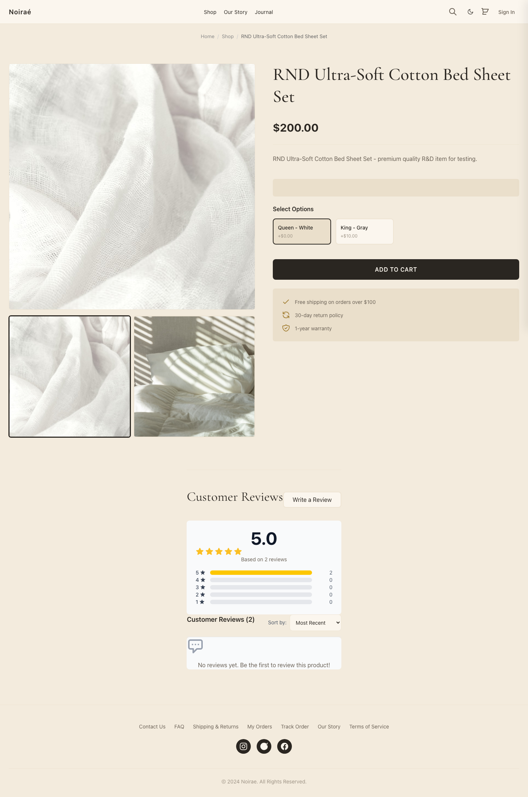
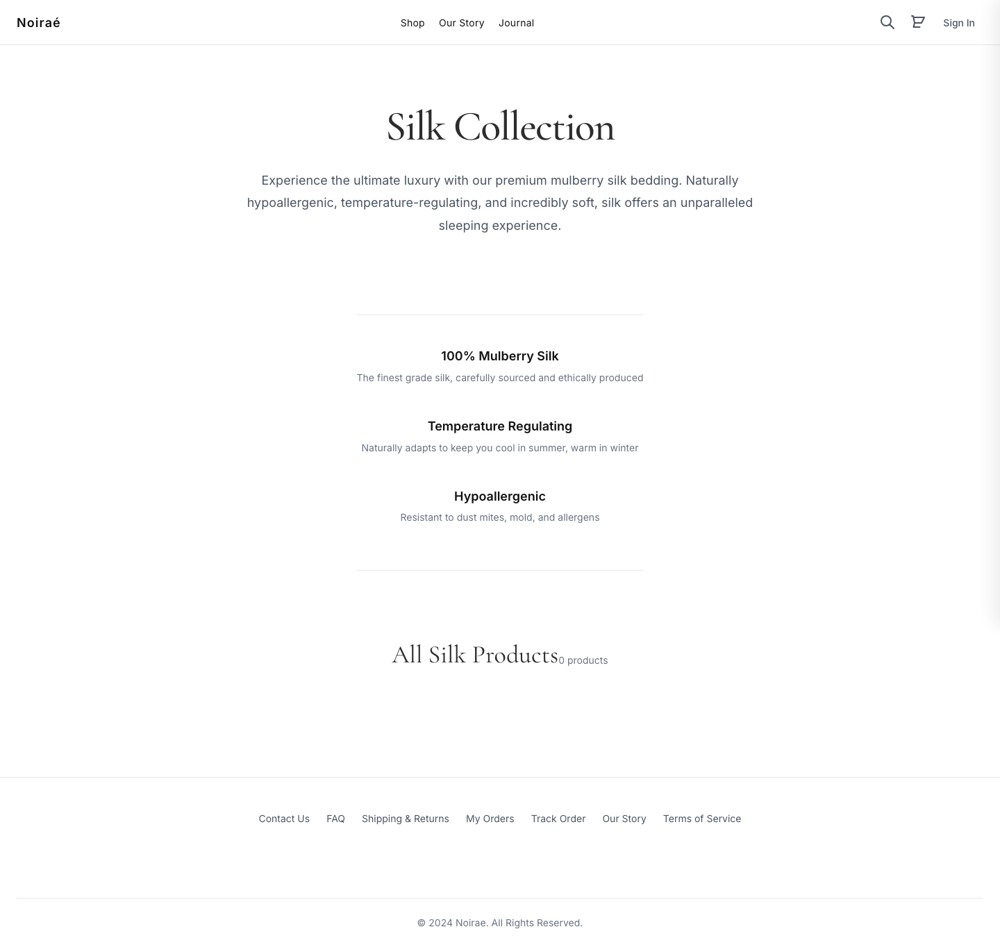
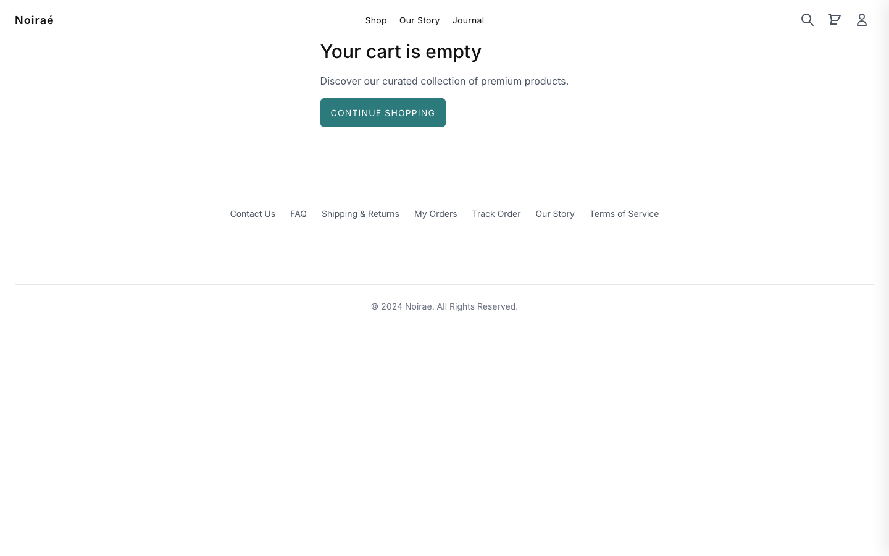
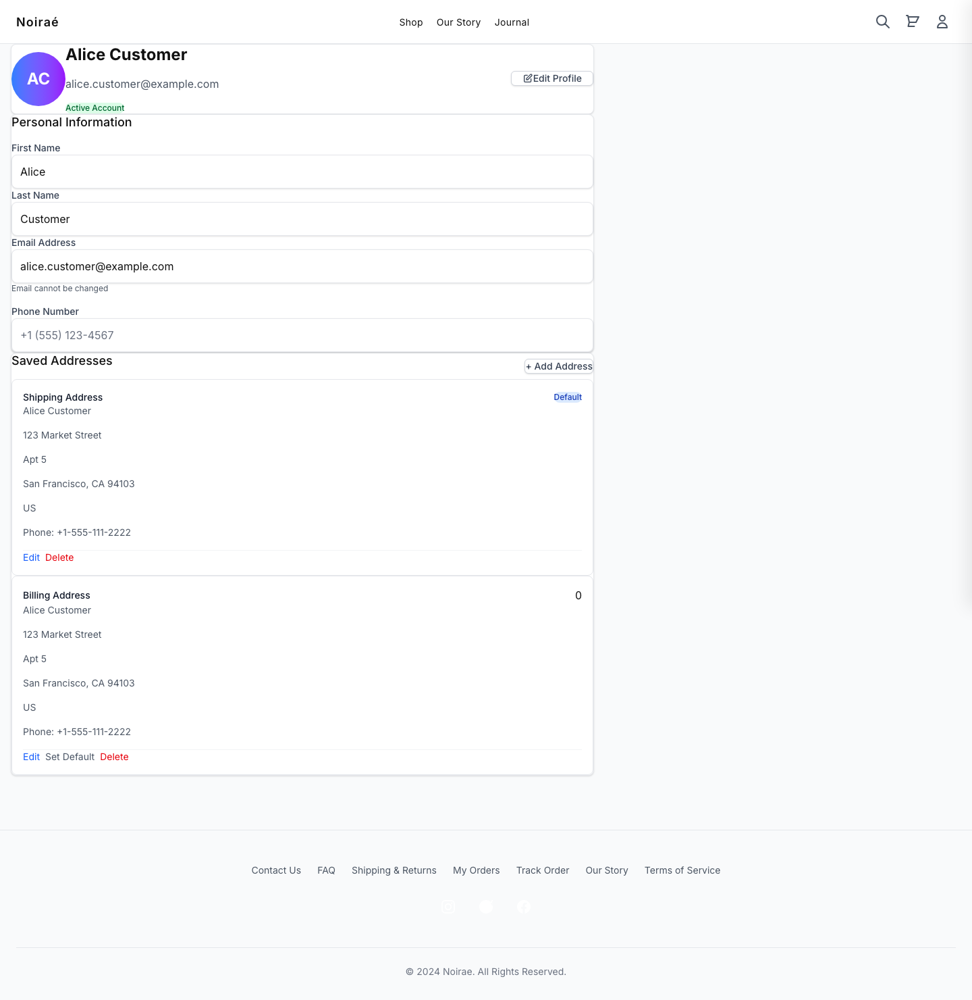
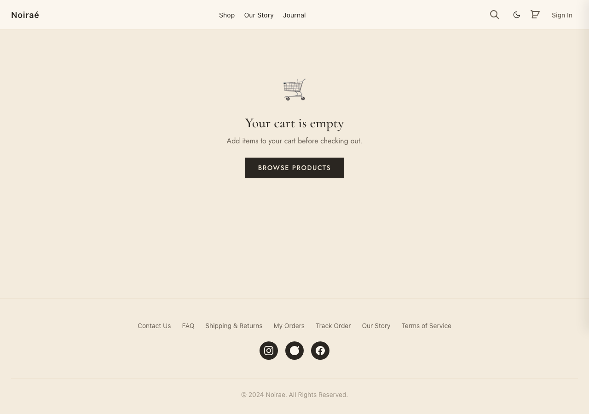
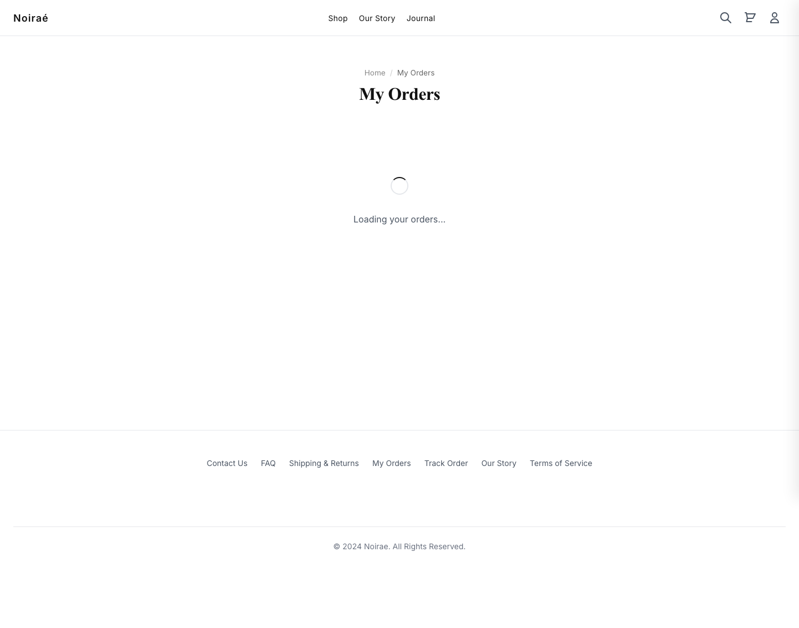
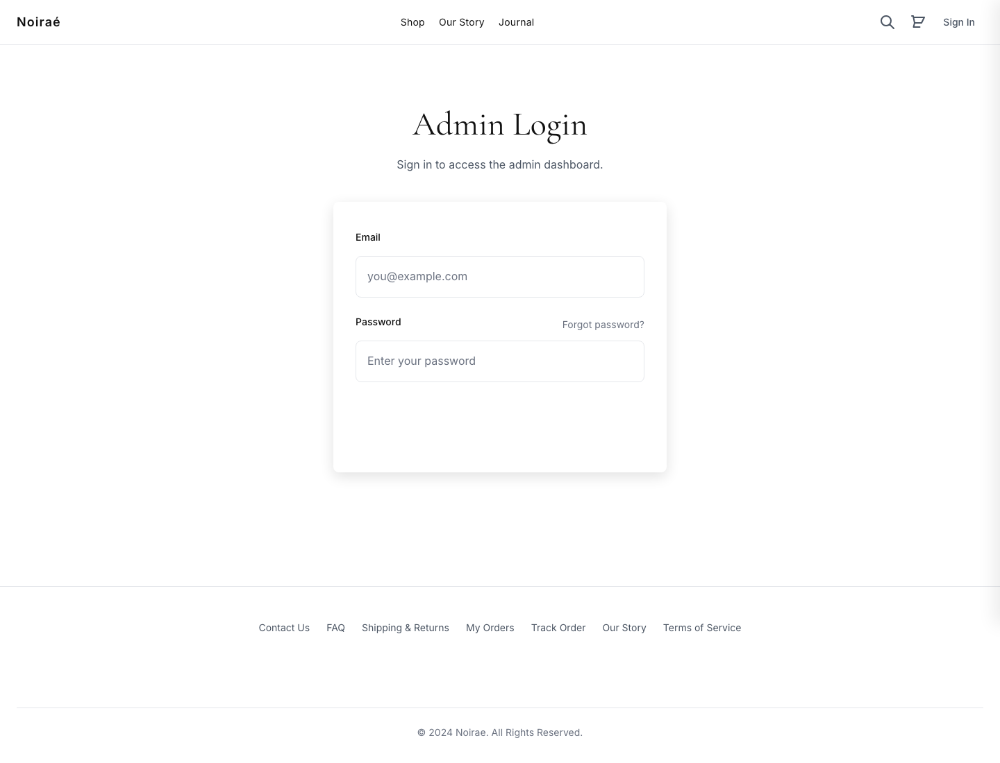

# NodeTexeure

A full-stack luxury bedding e-commerce platform (silk & cashmere) — customer
storefront, REST API, and admin dashboard. Pure JavaScript, no TypeScript, no
Docker.


> More screenshots: **[docs/screenshots/](docs/screenshots/)** (23 pages, full gallery below).

---

## What's inside

Three independent apps in one repo:

| App | Path | Stack | Port |
|-----|------|-------|------|
| **Storefront** (frontend) | `src/` | Next.js 15, React 19, Tailwind 4 | 3000 |
| **Backend API** | `backend/` | Express.js, MySQL, JWT | 6666 |
| **Admin dashboard** | `admin-dashboard/` | Next.js 14, React 18 | 3005 |

**Database:** MySQL 8.0+ (44 tables, custom prefixed IDs like `PROD0000000001`).
The frontend never touches the DB directly — it proxies `/api/*` to the backend
(see `next.config.mjs`).

---

## Quick start (≈5 minutes)

### 1. Prerequisites

- Node.js 18+ (tested on 22)
- MySQL 8.0+ running locally
- npm

### 2. Install dependencies

```bash
npm install
cd backend && npm install && cd ..
cd admin-dashboard && npm install && cd ..
```

### 3. Configure environment

```bash
cp .env.example .env                 # frontend (BACKEND_URL, NextAuth)
cp backend/.env.example backend/.env # backend (DB, secrets, integrations)
```

Then edit `backend/.env` and set `DB_PASSWORD` to your local MySQL password. All
third-party integrations (Stripe, AWS SES/S3, FedEx) are optional and degrade
gracefully — leave them as placeholders and the app logs instead of calling them.

### 4. Create and seed the database

```bash
# Make sure MySQL is running first, then:
npm run db:init                 # creates the `bed_texture_ecommerce` DB + schema
cd backend && npm run seed:rnd  # seeds demo products, users, orders
cd ..
```

### 5. Run

```bash
npm run dev        # starts frontend + backend + admin via PM2
```

Open **http://localhost:3000**.

### 6. Verify it works

```bash
npm run smoke      # checks the storefront + API proxy are healthy
```

---

## Demo accounts

Created by `npm run seed:rnd`:

| Role | Email | Password |
|------|-------|----------|
| Customer | `alice.customer@example.com` | `Customer@123` |
| Customer | `bob.customer@example.com` | `Customer@123` |
| Admin | `admin@example.com` | `Admin@123` |
| Staff | `staff@example.com` | `Staff@123` |

---

## Common commands

```bash
npm run dev            # start all three apps (PM2)
npm run dev:frontend   # storefront only (next dev)
npm run dev:backend    # backend only (nodemon)
npm run pm2:logs       # tail logs
npm run pm2:stop       # stop everything

npm run db:init        # create schema (safe to re-run)
npm run db:reset       # drop + recreate (dev only, destroys data)
npm run db:test        # test the DB connection

npm run test           # lint + production build (CI gate)
npm run smoke          # health-check the running stack
npm run lint           # ESLint only
```

Backend-only helpers (run from `backend/`):

```bash
npm run seed:rnd       # seed demo data
npm run email-daemon   # start the email queue processor
```

---

## Architecture

```
Browser ──► Storefront (Next.js, :3000)
                │  rewrites /api/* ──► Backend (Express, :6666) ──► MySQL
                │
            Admin dashboard (Next.js, :3005) ──► Backend
```

- **API proxy:** the storefront's `next.config.mjs` rewrites `/api/<route>/*` to
  the backend. The browser only ever talks to `:3000`.
- **Auth:** JWT via `Authorization` header or an `admin_auth` HttpOnly cookie;
  NextAuth manages the storefront session. Three middleware levels: `protect`,
  `admin`, `protectOptional`.
- **API responses:** every endpoint returns
  `{ status, message, keyValueTable }` via `backend/utils/responseFormatter.js`.
- **IDs:** a SQL function `get_next_id('PREFIX')` generates human-readable IDs
  (`USER0000000001`, `PROD0000000002`).

More detail: [`BACKEND.md`](BACKEND.md), [`FRONTEND.md`](FRONTEND.md),
[`DATABASE.md`](DATABASE.md), [`docs/PROJECT_STATUS.md`](docs/PROJECT_STATUS.md).

---

## Troubleshooting

**MySQL not running / connection refused**
```bash
npm run db:test           # confirm the backend can connect
```
Start MySQL, verify `DB_PASSWORD` in `backend/.env`, then re-run `db:init`.

**Backend on `:6666` looks unreachable in a browser**
Port 6666 is on the browser "bad ports" blocklist, so browsers (and Node's
`fetch`) refuse to connect to it directly. This is expected — the app reaches the
backend through the storefront proxy at `http://localhost:3000/api/*`. Use that,
or `curl http://localhost:6666/api/products` for a direct check.

**Port already in use**
```bash
lsof -ti:3000 | xargs kill -9   # (or :6666, :3005)
```

**Stale cache / weird build errors**
```bash
npm run clean         # clears .next and caches
```

---

## Screenshot gallery

All 23 storefront pages, captured from the running app. See
[`docs/screenshots/`](docs/screenshots/).

| | | |
|---|---|---|
|  |  |  |
| Home | Shop | Product detail |
|  |  |  |
| Silk collection | Cart | Profile (logged in) |
|  |  |  |
| Checkout | Orders | Login |

---

## Tech notes

- **No TypeScript** — plain JavaScript everywhere (ESNext, JSDoc where useful).
- **No Docker** — runs directly on the host.
- **Prepared statements** for all user input (SQL-injection safe).
- **Graceful degradation** — missing integration credentials fall back to console
  logging instead of failing.

## Working on this repo with Claude Code

This repo includes a `CLAUDE.md` with project conventions that Claude Code reads
automatically. Good first prompts: "run the app and take a screenshot",
"explain the API proxy setup", or "add an endpoint to the backend".
