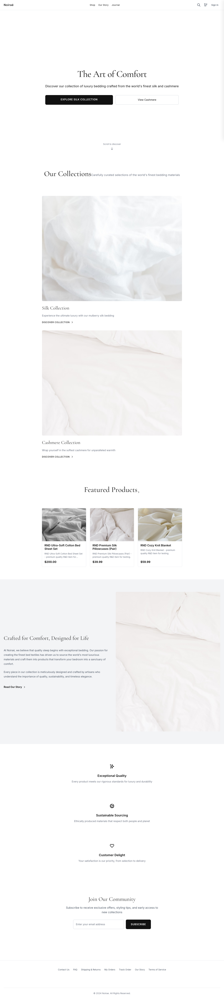
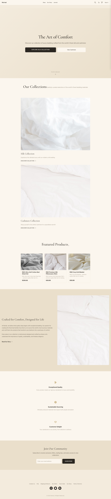

# NodeTexeure

[](https://github.com/PatrickSun93/nodeTexeure/actions/workflows/ci.yml)

A full-stack luxury bedding e-commerce platform (silk & cashmere) — customer
storefront, REST API, and admin dashboard. JavaScript (Next.js, Express),
TypeScript (the admin dashboard) and Rust (Axum, sqlx), MySQL. Design
direction: **"Champagne & Charcoal"** (warm, editorial, with a light + dark theme).



> Full page gallery: **[docs/screenshots/](docs/screenshots/)** · design language:
> **[docs/DESIGN.md](docs/DESIGN.md)** · all 30 redesign mockups: **[design/](design/)**

---

## What's inside

| App | Path | Stack | Port |
|-----|------|-------|------|
| **Storefront** | `src/` | Next.js 15, React 19, Tailwind 4 | 3000 |
| **Backend API** | `backend/` | Express.js, MySQL, JWT | 6666 |
| **Admin dashboard** | `admin-dashboard/` | Next.js 15, React 19, TypeScript (strict) | 3005 |
| **Rust API** | `rust/crates/api` | Axum, sqlx | 7000 |
| **Email daemon / worker** | `rust/crates/email-daemon`, `api` `worker` bin | Rust, sqlx | — |

The frontend never touches the DB directly — it proxies `/api/*` to the backend
(every `/api` group is served by the Rust API today; Express stays as the rollback
target, see [docs/adr/](docs/adr/)).
The DB (MySQL 8.0, ~42 tables) is seeded with **real example data** (orders, reviews,
product images, journal articles) — no mock data.

---

## Features

### Storefront (`:3000`)
- **Browse** — shop with filters, product detail with variants, collections, new
  arrivals, and search.
- **Cart & checkout** — multi-step checkout, coupon codes, tax + shipping, and an
  order-confirmation page. (Logged-in and guest carts both supported.)
- **Account** — register / sign in, profile + saved addresses, order history +
  order tracking, wishlist, and returns.
- **Reviews** — read and submit star-rated product reviews.
- **Content** — Journal (editorial blog, DB-backed with article pages), About,
  Contact, FAQ, Shipping & Returns, Terms, and an email **Unsubscribe** landing.
- **4 languages + dark mode** (see below).

### Admin dashboard (`:3005`)
- **Dashboard & analytics** — KPI tiles plus revenue trends vs. target, day-of-week
  share, best/worst sellers, a conversion funnel, new-vs-returning revenue, and
  "revenue drivers" shortfall analysis.
- **Orders** — list, detail, status updates (which email the customer), and refunds.
- **Products** — create / edit with variants and inventory, plus bulk upload.
- **Promotions** — coupon CRUD (percentage / fixed / free-shipping) with minimum
  order, usage limits, and expiry.
- **Reviews moderation** — approve / reject queue.
- **Email** — template editor and a queue monitor (queued / sent / failed counts,
  retry).
- **Customers**, **Staff & roles**, and **Settings**.

### Backend (`:6666`)
- REST API for everything above; **JWT + `admin_auth` cookie** auth, **CSRF** on
  admin writes, rate limiting, and prepared statements throughout.
- **Coupons** with minimum-order and usage-limit enforcement and discounts clamped
  to the subtotal (no negative totals).
- **Transactional emails** — order confirmation, shipping notification, welcome,
  password reset — via AWS SES, with a console/HTML fallback when SES isn't
  configured, plus a DB-backed email queue.
- **Inventory** with atomic stock decrement; **returns**; **Stripe** payments and
  **FedEx** shipping (both degrade gracefully to sensible defaults without keys).

---

## Multi-language

The storefront ships in four languages — **English**, **中文**, **Français**, and
**Español** — switched from a `LanguageSwitcher` in the header. Localization is
cookie-based `next-intl`: the switcher sets a `NEXT_LOCALE` cookie that's read
server-side, so there's deliberately **no `[locale]` URL segment**. Product copy is
localized too — the backend serves translated names and descriptions from the
`product_translations` table. (Transactional emails stay English by design.)

---

## Quick start

### With Docker (recommended)

```bash
docker compose up
```

That's it. On first run it creates the schema and seeds demo + example data. Open
**http://localhost:3000** (admin at **http://localhost:3005**). Hot-reload is on.

### Without Docker

Requires Node 18+ and a local MySQL 8.0.

```bash
npm install && (cd backend && npm install) && (cd admin-dashboard && npm install)
cp .env.example .env && cp backend/.env.example backend/.env   # set DB_PASSWORD in backend/.env
npm run db:init                                                 # create schema
cd backend && npm run seed:rnd && npm run seed:example && cd .. # demo + example data
npm run dev:frontend    # storefront (:3000)
npm run dev:backend     # backend (:6666), in another terminal
```

Verify: `npm run test` (lint + build) and `npm run smoke` (stack health).

### Demo accounts

| Role | Email | Password |
|------|-------|----------|
| Customer | `alice.customer@example.com` | `Customer@123` |
| Admin | `admin@example.com` | `Admin@123` |
| Staff | `staff@example.com` | `Staff@123` |

---

## Commands

```bash
docker compose up            # full dev stack (mysql + 3 apps, hot-reload)
docker compose exec backend npm run seed:example   # re-seed example data
docker compose -f docker-compose.prod.yml up -d --build   # production stack

npm run test     # ESLint + production build (CI gate)
npm run smoke    # health-check the running stack
npm run db:reset # drop + recreate schema (dev only)
node scripts/gen-api-docs.js   # regenerate docs/API.md after changing routes
```

New DB columns/tables ship as ordered migrations under
[`backend/migrations/`](backend/migrations/). The backend applies pending ones on
startup (`cd backend && npm run migrate`, `-- --status` to inspect), tracked in the
`schema_migrations` table.

---

## The design — Champagne & Charcoal

Warm champagne surfaces, charcoal ink, gold accents; Cormorant Garamond display
type over Jost. A full **dark mode** ("Charcoal & Candlelight") ships via the theme
toggle in the header. Everything is driven by `--noirae-*` design tokens, so one
token block re-skins the whole app. Palette, fonts, and theming details:
**[docs/DESIGN.md](docs/DESIGN.md)**.

|  |  |
|---|---|
|  | Light (champagne) |

---

## Architecture

```
Browser ─► Storefront (Next.js, :3000)
                │  rewrites /api/* ─► Backend (Express, :6666) ─► MySQL
            Admin dashboard (Next.js, :3005) ─► Backend
            Email daemon (Rust) ─► MySQL email_queue ─► AWS SES
```

- **API proxy:** the browser only talks to `:3000`; the backend port `6666` is a
  browser-blocked port, so all API access goes through the proxy.
- **Auth:** JWT + an `admin_auth` cookie; middleware levels `protect`,
  `protectOptional`, `staffOrAdmin`, `admin`; admin writes require a CSRF token.
  Tokens are checked against the user's current role/status on every request, so
  revocation is immediate. Customer and admin auth flows are separate.
- **IDs:** human-readable prefixed IDs (`PROD0000000001`) via a `get_next_id` SQL
  function.

---

## Testing & quality

- **`npm run test`** — ESLint + production `next build`.
- **`cd admin-dashboard && npm run typecheck`** — strict TypeScript check of the
  admin dashboard (CI runs it with the admin's lint and build).
- **`cd backend && npm test`** — API tests (Jest + supertest) against the seeded
  MySQL. CI runs both apps' lint/build, these tests, and `npm audit` on every PR.
- **`npm run smoke`** — checks the running stack (storefront pages + backend via
  the proxy).
- **Security posture is tested** — privilege escalation, IDOR, SQL injection, JWT
  forgery (incl. `alg:none`), revoked sessions and missing CSRF are covered by the
  API tests. New admin routes go under `admin` or `staffOrAdmin` (+ CSRF for writes)
  and get a test.

---

## Documentation

- **[CLAUDE.md](CLAUDE.md)** / **[AGENTS.md](AGENTS.md)** — guide for AI agents
  (Claude Code, Codex): architecture, gotchas, conventions.
- **[docs/DESIGN.md](docs/DESIGN.md)** — the Champagne & Charcoal design system.
- **[docs/ADD_A_FEATURE.md](docs/ADD_A_FEATURE.md)** — how to add a feature end-to-end.
- **[docs/DATABASE.md](docs/DATABASE.md)** — schema, custom IDs, migrations, status values.
- **[docs/API.md](docs/API.md)** — every endpoint and its access rule (generated from the routes).
- **[docs/DEPLOYMENT.md](docs/DEPLOYMENT.md)** — production stack, Stripe webhook, ops, launch checklist.
- **[backend/README.md](backend/README.md)** — backend layout, scripts, running the tests.
- **[rust/README.md](rust/README.md)** — the Rust services: API, worker, email daemon.
- **[docs/adr/](docs/adr/)** — architecture decision records (the Rust port, parity
  tests, sqlx offline data).

---

## Troubleshooting

**Backend `:6666` unreachable in a browser** — expected; 6666 is a browser
blocked-port. Use the storefront proxy (`:3000/api/*`).

**MySQL / DB issues** — `npm run db:test`; with Docker, `docker compose logs mysql`.

**Port already in use** — `lsof -ti:3000 | xargs kill -9` (or `:6666`, `:3005`).

**Admin page renders but won't respond** — hard-refresh once; a stale dev service
worker can serve outdated chunks. **Stale build** — `npm run clean`.
